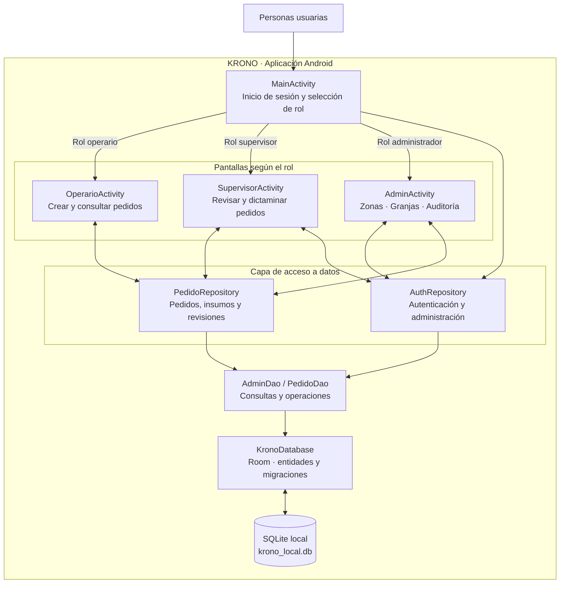

# KRONO — Documentación técnica y funcional

> Aplicación Android para gestionar solicitudes de insumos agrícolas entre operarios de granja, supervisores y administración.

## 1. ¿Qué es KRONO?

KRONO es una aplicación móvil Android que centraliza el registro, seguimiento y revisión de pedidos de insumos agrícolas. La información se organiza por zonas y granjas, y cada solicitud puede contener varios insumos, cantidades y observaciones.

La aplicación utiliza una base de datos local SQLite, gestionada mediante Room. Por tanto, el flujo de trabajo descrito en este documento ocurre en el dispositivo donde está instalada la APK; este repositorio no evidencia un servidor remoto ni sincronización en la nube.

## 2. Funcionalidades principales

- Inicio de sesión con selección de rol: operario, supervisor o administrador.
- Registro y consulta de pedidos de insumos asociados a una granja, lote y zona.
- Consulta del historial y estado de los pedidos.
- Revisión de solicitudes por parte del supervisor, con aprobación, ajuste o rechazo de cantidades y observaciones.
- Administración de zonas, granjas e inventario.
- Registro de eventos de auditoría para operaciones administrativas.
- Consulta de revisiones y generación/exportación de información de pedidos desde las pantallas de supervisión.

## 3. Actores del sistema

| Actor | Responsabilidades |
|---|---|
| **Operario de granja** | Inicia sesión, prepara solicitudes de insumos para su granja/lote, las envía a revisión y consulta sus pedidos y estados. |
| **Supervisor** | Consulta pedidos por zona y granja, revisa cada solicitud, aprueba, ajusta o rechaza insumos, registra observaciones y consulta el historial. |
| **Administrador** | Gestiona zonas y granjas, activa o desactiva registros, administra información de inventario y consulta la auditoría. |

Los tres roles se seleccionan en la pantalla de acceso. La autenticación comprueba también que el rol solicitado coincida con el rol registrado para el usuario.

## 4. Metodología de desarrollo

El proyecto adopta la **metodología en cascada** como guía de organización del desarrollo. Sus etapas se entienden de la siguiente manera:

1. **Análisis:** identificación de los actores, necesidades y flujo de solicitudes de insumos.
2. **Diseño:** definición de pantallas, navegación por roles, entidades de datos y relaciones entre pedidos, insumos, usuarios, zonas y granjas.
3. **Implementación:** construcción de la aplicación Android en Java, interfaces XML y persistencia local con Room sobre SQLite.
4. **Pruebas:** comprobación del inicio de sesión, operaciones por rol, registro y revisión de pedidos, persistencia y navegación.
5. **Entrega y mantenimiento:** generación de la APK, instalación y corrección evolutiva de errores.

La cascada describe la organización del proyecto; no es una función que se ejecute dentro de la APK. Las correcciones posteriores pueden implicar volver a una etapa anterior.

## 5. Arquitectura e interacción de los componentes

El diseño separa las pantallas (Activities), la lógica de acceso a datos (Repositories), las interfaces de consulta (DAO) y el almacenamiento local (Room/SQLite).

El siguiente diagrama Mermaid resume el recorrido principal de la información:



### Responsabilidad de cada capa

- **Activities:** muestran las interfaces y reciben las acciones de las personas usuarias.
- **Repositories:** concentran operaciones de autenticación, pedidos y administración. Ejecutan operaciones de base de datos en un ejecutor de trabajo y devuelven resultados a la interfaz.
- **DAO (Data Access Objects):** define las consultas y operaciones para leer y modificar los registros.
- **Room:** convierte las entidades Java en tablas y facilita el acceso tipado a SQLite.
- **SQLite:** conserva localmente usuarios, zonas, granjas, inventario, pedidos, insumos, revisiones y auditoría.

## 6. Tecnologías utilizadas

| Tecnología | Uso en KRONO |
|---|---|
| Android / Android SDK | Plataforma de ejecución de la aplicación. |
| Java 11 | Lenguaje principal de la aplicación. |
| XML | Definición de interfaces y recursos visuales. |
| AndroidX y Material Components | Componentes de interfaz y compatibilidad. |
| Room | Capa de persistencia y mapeo objeto-relacional sobre SQLite. |
| SQLite | Base de datos local del dispositivo. |
| Gradle Kotlin DSL | Configuración y construcción del proyecto. |
| Git y GitHub | Control de versiones y alojamiento del código fuente. |

## 7. Datos y seguridad de contraseñas

En el flujo de autenticación, KRONO guarda en la entidad `UserEntity` el campo `passwordHash`, no la contraseña original. El repositorio de autenticación genera un valor derivado mediante **PBKDF2WithHmacSHA1**, con una sal aleatoria de 16 bytes, 120.000 iteraciones y una salida de 256 bits. El valor persistido se representa como `sal:hash`.

Al iniciar sesión, la aplicación vuelve a derivar el valor a partir de la contraseña introducida y la sal almacenada, y compara ambos resultados. No necesita recuperar ni descifrar la contraseña original. Esto es preferible a guardar la contraseña directamente como texto legible.

**Importante: hay una salvedad en el código actual.** Aunque la tabla `usuarios` utiliza `passwordHash`, la entidad y las operaciones de granjas también manejan un campo llamado `password`. En el código revisado, al crear o actualizar una granja se persiste la contraseña en ese campo además de guardar un hash en `usuarios`. Por tanto, no sería correcto afirmar que la APK nunca almacena contraseñas en texto plano: el mecanismo de autenticación usa hash, pero el modelo de granjas conserva también una copia legible. Se recomienda eliminar ese almacenamiento duplicado y migrar los datos existentes antes de considerar resuelto ese aspecto de seguridad.

Además, PBKDF2 es una función de derivación unidireccional, no cifrado reversible. El hash reduce el impacto de una lectura de la tabla de usuarios, pero no sustituye otras medidas como proteger el dispositivo, controlar copias de seguridad, limitar intentos de acceso y revisar las credenciales de demostración.

## 8. Estructura relevante del código

```text
app/src/main/
├── java/com/example/ferreteria/
│   ├── MainActivity.java
│   ├── OperarioActivity.java
│   ├── SupervisorActivity.java
│   ├── AdminActivity.java
│   ├── StatusBarUtils.java
│   └── data/
│       ├── AuthRepository.java
│       ├── PedidoRepository.java
│       ├── KronoDatabase.java
│       ├── dao/
│       │   ├── AdminDao.java
│       │   └── PedidoDao.java
│       └── entity/
│           ├── UserEntity.java
│           ├── PedidoEntity.java
│           ├── InsumoPedidoEntity.java
│           ├── ZoneEntity.java
│           ├── FarmEntity.java
│           ├── InventoryEntity.java
│           ├── RevisionPedidoEntity.java
│           └── AuditEntity.java
└── res/
    ├── layout/
    ├── drawable/
    └── values/
```

## 9. Alcance y consideraciones

- La base de datos se crea como `krono_local.db` en el almacenamiento privado de la aplicación.
- Room está configurado actualmente con la versión de esquema 5 y migraciones entre versiones.
- La aplicación incluye datos iniciales de demostración para zonas, granjas, usuarios e inventario cuando corresponde.
- El uso de SQLite local significa que los datos no se comparten automáticamente entre distintos dispositivos.
- La documentación describe la implementación que se observa en el código fuente de la rama `master`; no afirma que se hayan completado pruebas en dispositivos o emuladores que no estén documentadas.

## 10. Archivos principales

- [Código fuente](https://github.com/Edwinsebastian-crypto/KRONO/tree/master/app/src/main/java/com/example/ferreteria)
- [Base de datos Room](https://github.com/Edwinsebastian-crypto/KRONO/blob/master/app/src/main/java/com/example/ferreteria/data/KronoDatabase.java)
- [Autenticación](https://github.com/Edwinsebastian-crypto/KRONO/blob/master/app/src/main/java/com/example/ferreteria/data/AuthRepository.java)
- [Repositorio de pedidos](https://github.com/Edwinsebastian-crypto/KRONO/blob/master/app/src/main/java/com/example/ferreteria/data/PedidoRepository.java)
